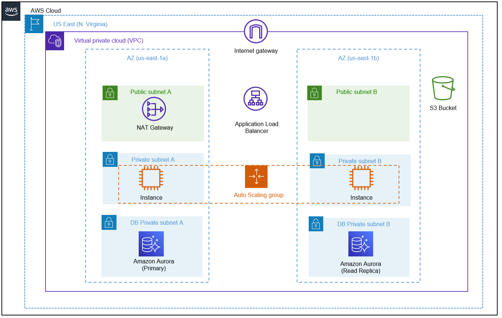

# Highly Available Web Application on AWS: Cloud Architecture & Deployment

Design and deployment of a **secure, scalable and highly available** cloud architecture on **AWS** for a café ordering web application (PHP + MySQL). The design follows the **AWS Well-Architected Framework**.

> Cloud Infrastructure & Services group project (4 members). I owned the **Deployment** workstream: EC2, the web stack, the custom AMI and S3 backups. The team designed the VPC together. Security (Parameter Store/WAF), data migration (RDS) and high availability (ALB/Auto Scaling) were handled by teammates.

---

## Architecture (team)
- **VPC** across **two Availability Zones**, with public and private subnets
- **Internet Gateway**, **NAT Gateway** and an **Elastic IP**
- **Application Load Balancer** in the public subnets → **EC2 Auto Scaling group** in the private subnets
- **Amazon RDS / Aurora (MySQL)** in isolated DB subnets (primary + read replica)
- **Amazon S3** for static assets and backups
- Layered security: Security Groups, NACLs, IAM roles, Parameter Store / Secrets Manager, WAF
- **CloudWatch** monitoring

## My Contribution: Deployment
| Task | Details |
|---|---|
| **EC2 provisioning** | Amazon Linux 2023, `t2.small`, RSA key pair, 8 GB gp3, placed in the project VPC's public subnet |
| **Security group** | SSH (22) restricted to a single admin IP; HTTP (80) open for web traffic |
| **Web stack** | Installed and enabled **Apache (httpd)** and **PHP 8.4** with `dnf`, and verified with `phpinfo()` |
| **Application deployment** | Uploaded the app with **SCP**, deployed it to `/var/www/html` with correct ownership and permissions |
| **Golden image** | Built a custom **AMI** (`cafe-ami-v1`) for fast, consistent scaling |
| **S3 backups** | Private S3 bucket for website backups, accessed through an **IAM role** (no hard-coded keys), with a verified backup process |

## Skills Demonstrated
AWS networking (VPC, subnets, route tables, IGW/NAT) · EC2 and AMIs · Linux server administration · Apache/PHP · S3 and IAM roles · Well-Architected design

## Tools
AWS (EC2, VPC, S3, IAM, RDS, ALB, Auto Scaling, CloudWatch) · Amazon Linux 2023 · Apache · PHP · SSH/SCP

## Author
**Sultan Mohammed Rabea** · [LinkedIn](https://www.linkedin.com/in/sultan-rabea/) · [GitHub](https://github.com/sultanrabea4)
